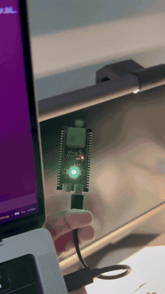

# halo-esp32s3

<p align="center"></p>
<p align="center"><a href="docs/demo.mp4">Full video</a></p>

Control a first-generation BenQ ScreenBar Halo from an ESP32-S3 using its own radio, no external RF module needed.

Uses private Espressif PHY functions. Wi-Fi is unavailable while this firmware runs.

> [!WARNING]
> Driving the radio through these private PHY paths is not intended or qualified for productive use and may permanently alter the radio's analog characteristics.

## Hardware

1. ESP32-S3 (I only have an ESP32-S3-WROOM-1 N8R8 to test with; other modules are untested)
2. Your Screenbar's 4-byte pairing address (this project does not discover it)

## Build and flash

```sh
git clone https://github.com/espressif/esp-idf.git
cd esp-idf
git checkout 25fe69f946311abdaf9ad56591f25fedbc20ac98
git submodule update --init --recursive
./install.sh esp32s3
. ./export.sh

cd /path/to/halo-esp32s3
idf.py set-target esp32s3
idf.py -p /dev/ttyACM0 flash
```

## Use

```sh
pip install pyserial
python tools/halo_control.py --address A1B2C3D4 --mode back --brightness 50
python tools/halo_control.py --help
```

Modes: `off`, `front`, `back`, `both`. Brightness 0..100. `--led on` lights the onboard LED and blinks it on ACK; `--led off` turns it off. Exit status is non-zero without an ACK.

## Serial protocol

Newline-terminated ASCII over USB. Type `HELP` for the full list.

```text
HALO <address_hex> <mode 0-3> <brightness 0-100> <pid 0-3> <gain 0-10> <attempts 1-5>
  -> HALODONE <ACK|NO_ACK|RX_ERROR> <attempts> <payload_hex> <crc16> <synth_us> <total_us> <turnaround_us> <ack_us> <ack_crc16>
LED <r> <g> <b>        -> OK LED r g b
```

## Acknowledgements

- Receive path (PHY setup, tuning, calibration): [ESPARGOS/esp-sdr](https://github.com/ESPARGOS/esp-sdr)
- Transmit path (DAC playback, power table): [cyber-murmel/esp-sdr-zephyr](https://github.com/cyber-murmel/esp-sdr-zephyr)
- ScreenBar Halo protocol: [Djoko-cli/benq-screenbar-halo-matter](https://github.com/Djoko-cli/benq-screenbar-halo-matter)

## License

GPL-3.0. See [LICENSE](LICENSE) and [docs/NOTICE](docs/NOTICE).
